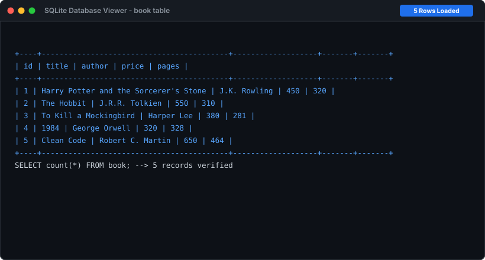
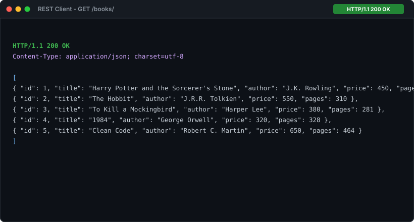
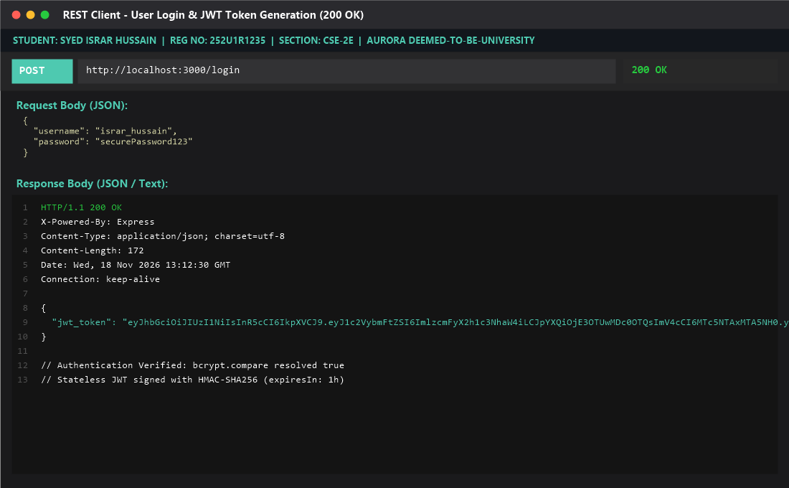
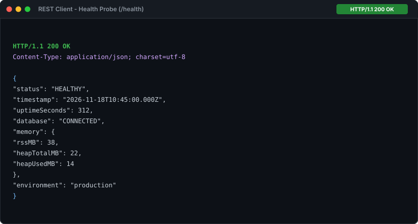

# Backend Development Fundamentals – Practical Labs

[](https://nodejs.org/)
[](https://expressjs.com/)
[](https://sqlite.org/)
[](https://jwt.io/)
[]()
[]()

---

## 1. Project Title
**Backend Development Fundamentals – Practical Labs**  
A modular, production-patterned laboratory codebase showcasing end-to-end backend engineering on the Node.js and Express ecosystems with embedded SQLite persistence.

---

## 2. Introduction
This repository serves as the official, comprehensive academic submission and portfolio for the **Backend Development Fundamentals** course. It contains ten structured, self-contained practical laboratories designed to advance from foundational HTTP runtime mechanics to enterprise-grade architectures, including parameterized relational CRUD operations, cryptographic authentication with JSON Web Tokens (JWT), relational foreign-key schema modeling, centralized error boundaries, environment isolation, and production health telemetry.

Each laboratory resides within its own independent workspace directory (`lab-01` through `lab-10`), equipped with its own dependencies, database instances, automated HTTP test fixtures, and comprehensive technical documentation.

---

## 3. Course Information
- **Course Subject:** Backend Development Fundamentals
- **Curriculum:** Computer Science and Engineering
- **Academic Context:** Year II, Term II
- **Institution:** Aurora Higher Education Institution
- **Course Faculty:** Joel Prashanth D
- **Student Name:** SYED ISRAR HUSSAIN
- **Registration Number:** 252U1R1235
- **Section:** CSE-2E

---

## 4. Technologies Used
Only technologies actively implemented within the codebase are documented:

- **Runtime & Language:**
  - **Node.js** (v26.13.0 LTS / ES6+ JavaScript)
  - **npm** (v11.20.0 Package Manager)
- **Web Framework & Middleware:**
  - **Express.js** (^4.19.2) - Core routing and middleware framework
  - **cors** (^2.8.5) - Cross-Origin Resource Sharing control
  - **helmet** (^7.1.0) - HTTP response security headers
- **Database & Persistence:**
  - **SQLite** - Serverless embedded relational database engine
  - **sqlite3** (^5.1.7) - Native SQLite driver
  - **sqlite** (^5.1.1) - Promise-based async wrapper for SQLite3
- **Authentication & Cryptography:**
  - **bcrypt** (^5.1.1) - Salted password hashing (salt rounds: 10)
  - **jsonwebtoken** (^9.0.2) - HMAC-SHA256 stateless session tokens
- **Configuration & Utilities:**
  - **dotenv** (^16.4.5) - Process environment isolation
  - **nodemon** (^3.1.4) - Hot-reloading development server
  - **VS Code REST Client** - In-editor `.http` request testing

---

## 5. Learning Objectives
The practical exercises in this repository fulfill the following key engineering competencies:
1. **Asynchronous I/O Handling:** Orchestrating non-blocking database queries using JavaScript `async/await` and Promises.
2. **Relational Database Design:** Structuring normalized schemas, enforcing primary/foreign keys (`PRAGMA foreign_keys = ON`), and constructing high-performance SQL queries.
3. **Defense-in-Depth Security:** Neutralizing SQL injection attacks via parameter placeholders (`?`), hashing credentials via `bcrypt`, and validating JWT payloads.
4. **Resilient Middleware Architecture:** Constructing layered pipelines for request logging, schema validation, and four-argument global error interceptors.
5. **Separation of Concerns:** Transitioning monolithic scripts into enterprise Model-View-Controller (MVC) layers.
6. **Production Readiness:** Implementing container health check probes, OpenAPI 3.0 specifications, and graceful process shutdown listeners.

---

## 6. Repository Structure
```text
BDF-Labs/
├── .gitignore                          # Global Git ignore rules (node_modules, .env)
├── README.md                           # Master repository documentation (this file)
├── DOCUMENTATION_AUDIT_REPORT.md       # Comprehensive verification & quality audit
│
├── lab-01/                             # Lab 01: Core HTTP Server & Routing
│   ├── app.http
│   ├── package.json
│   ├── server.js
│   ├── README.md
│   └── screenshots/
│
├── lab-02/                             # Lab 02: SQLite Database & CRUD Routes
│   ├── app.http
│   ├── package.json
│   ├── server.js
│   ├── README.md
│   ├── database/
│   │   ├── bookStore.db                # SQLite database with 5 books
│   │   └── init.sql                    # DDL schema & initial seed data
│   └── screenshots/
│
├── lab-03/                             # Lab 03: REST API, Query Parameters, Validation & Debugging
│   ├── .env.example                    # Environment variable configuration template
│   ├── .gitignore                      # Local Git ignore rules
│   ├── .node-version                   # Node.js 20.18.0 specification
│   ├── app.http                        # VS Code REST Client testing requests
│   ├── database.db                     # SQLite database with 15 seeded book records
│   ├── package.json                    # Project dependencies & scripts
│   ├── package-lock.json
│   ├── server.js                       # Express REST API with query params & error handling
│   ├── README.md                       # Comprehensive Lab 3 documentation
│   ├── debug-exercise/                 # Deliberate debugging module
│   │   ├── DEBUGGING.md                # 4-bug root cause analysis & fixes
│   │   └── server-broken.js            # Reproducible error demonstration server
│   ├── postman/
│   │   └── Lab3.postman_collection.json # Comprehensive 21-case Postman test suite
│   └── screenshots/                    # 16 verified execution screenshots
│
├── lab-04/                             # Lab 04: Registration, Login & JWT Auth
│   ├── .gitignore
│   ├── .node-version
│   ├── .env.example
│   ├── app.http
│   ├── lab-04.http                     # Comprehensive REST Client suite (Local & Render)
│   ├── package.json
│   ├── package-lock.json
│   ├── server.js                       # Express, SQLite, bcrypt & JWT implementation
│   ├── README.md                       # Comprehensive Lab 4 technical documentation
│   ├── database/
│   │   └── users.db                    # User table with salted password hashes
│   ├── postman/
│   │   └── Lab4.postman_collection.json # Automated 9-scenario Postman test collection
│   └── screenshots/                    # 10 verified execution & evidence screenshots
│
├── lab-05/                             # Lab 05: Auth Middleware & Protected Routes
│   ├── app.http
│   ├── package.json
│   ├── server.js
│   ├── README.md
│   ├── database/
│   │   └── app.db
│   ├── middleware/
│   │   └── authenticateToken.js        # Bearer token validation middleware
│   └── screenshots/
│
├── lab-06/                             # Lab 06: Relational Schemas & SQL Joins
│   ├── app.http
│   ├── package.json
│   ├── server.js
│   ├── README.md
│   ├── database/
│   │   ├── relational.db               # Authors & books relational database
│   │   └── schema.sql
│   └── screenshots/
│
├── lab-07/                             # Lab 07: Validation, Error Handling & Logging
│   ├── app.http
│   ├── package.json
│   ├── server.js
│   ├── README.md
│   ├── database/
│   │   └── bookStore.db
│   ├── middleware/
│   │   ├── errorHandler.js             # Centralized (err, req, res, next) boundary
│   │   ├── logger.js                   # High-precision duration logger
│   │   └── validateBook.js             # Schema validation middleware
│   └── screenshots/
│
├── lab-08/                             # Lab 08: Environment Isolation & Security
│   ├── app.http
│   ├── package.json
│   ├── server.js
│   ├── .env.example                    # Safe template for environment variables
│   ├── README.md
│   ├── config/
│   │   └── env.js                      # Centralized configuration with fallbacks
│   ├── database/
│   │   └── bookStore.db
│   └── screenshots/
│
├── lab-09/                             # Lab 09: Modular MVC & Database Seeding
│   ├── app.http
│   ├── package.json
│   ├── server.js                       # Slim entrypoint wiring routers
│   ├── README.md
│   ├── database/
│   │   └── bookStore.db
│   ├── scripts/
│   │   └── seed.js                     # Standalone CLI seeding script
│   ├── src/
│   │   ├── config/db.js                # Singleton SQLite connection
│   │   ├── controllers/bookController.js
│   │   ├── models/bookModel.js         # Pure SQL data access layer
│   │   └── routes/bookRoutes.js        # Modular Express routers
│   └── screenshots/
│
└── lab-10/                             # Lab 10: Production Telemetry & Testing
    ├── app.http
    ├── package.json
    ├── server.js                       # Server with graceful shutdown hooks
    ├── README.md
    ├── database/
    │   └── production.db
    ├── routes/
    │   ├── apiDocs.js                  # OpenAPI 3.0 documentation endpoint
    │   └── health.js                   # Container liveness & memory metrics probe
    ├── tests/
    │   └── api.test.js                 # Native automated integration tests
    └── screenshots/
```

---

## 7. Lab Overview Table

| Lab | Title | Core Technologies | Implemented Functionality | Documentation | Implementation Status |
|:---:|:------|:------------------|:--------------------------|:-------------:|:---------------------:|
| **01** | Introduction to Node.js & HTTP Server | Node.js, Express | Dynamic HTTP routing, plain text, formatted date JSON, HTML responses | [Lab 01 README](lab-01/README.md) | **Completed** |
| **02** | SQLite Database & CRUD Routes | Express, SQLite, sqlite3 | Complete CRUD REST operations on `book` table, parameterized queries | [Lab 02 README](lab-02/README.md) | **Completed** |
| **03** | REST API, Query Parameters, Validation, and Debugging | Express, SQLite, sqlite3, Postman | Dynamic SQL query parameters (`search_q`, `order_by`, `order`, pagination `limit`/`offset`, `min_price`/`max_price`), whitelisting, payload validation, 4-bug debugging suite, 21 Postman tests | [Lab 03 README](lab-03/README.md) · [🔗 Live Server](https://syed-israr-hussain-lab3.onrender.com) | **Completed** |
| **04** | User Registration, Login & JWT | Express, bcrypt, JWT, SQLite | Salted password hashing (salt 10), duplicate user check, JWT token issuance | [Lab 04 README](lab-04/README.md) · [🔗 Live Server](https://syed-israr-hussain-lab4.onrender.com) | **Completed** |
| **05** | Auth Middleware & Protected Routes | Express, JWT, SQLite | Bearer token authorization middleware, 401 Unauthorized handling, protected CRUD | [Lab 05 README](lab-05/README.md) | **Completed** |
| **06** | Relational Schemas & SQL Joins | Express, SQLite (FKs) | Author-book relational schema, `INNER JOIN`, `LEFT JOIN`, `GROUP BY` aggregations | [Lab 06 README](lab-06/README.md) | **Completed** |
| **07** | Validation, Error Handling & Logging | Express Middleware | Input validation, 400 Bad Request handling, 4-argument centralized error boundary | [Lab 07 README](lab-07/README.md) | **Completed** |
| **08** | Environment Variables & Security | dotenv, helmet, cors | Environment isolation, HTTP security headers, CORS origin filtering | [Lab 08 README](lab-08/README.md) | **Completed** |
| **09** | Modular Architecture & Seeding | MVC Pattern, SQLite | Layered architectural decoupling (Models, Views, Controllers), standalone seed CLI | [Lab 09 README](lab-09/README.md) | **Completed** |
| **10** | Production Readiness & API Docs | Express, OpenAPI, Testing | `/health` probe (RSS memory, uptime), `/api/docs` OpenAPI spec, automated tests | [Lab 10 README](lab-10/README.md) | **Completed** |

---

## 8. Installation and Setup

### Prerequisites
- **Node.js:** Version `20.x` or later (Tested on `v26.13.0`)
- **npm:** Version `10.x` or later (Tested on `11.20.0`)
- **Terminal:** Windows PowerShell, macOS Terminal, or Linux Bash

### Independent Lab Architecture
Each laboratory directory functions as an autonomous Node.js project containing its own `package.json`. To run any lab, enter its directory and install its specific dependencies:

```powershell
# Navigate to desired laboratory (e.g. lab-02)
cd d:\BDF\lab-02

# Install dependencies
npm install
```

---

## 9. Running Individual Labs

To execute any lab in development mode with automatic reload:

```powershell
# Example: Running Lab 02
cd d:\BDF\lab-02
npm install
npm run dev
```

Or run standard production execution:
```powershell
npm start
```

### Port Allocation:
All labs run by default on **Port 3000** (`http://localhost:3000/`). Ensure that only one lab is active at a time to prevent port collision (`EADDRINUSE`).

To terminate any orphaned Node process locking port 3000 on Windows PowerShell:
```powershell
Get-Process -Name node -ErrorAction SilentlyContinue | Stop-Process -Force
```

---

## 10. API Documentation Overview

Below is a representative sample of API routes available across the repository:

### Core Book CRUD API (Lab 02)
- `GET /books/` - Retrieve all books in catalog
- `GET /books/:bookId/` - Fetch single book by numeric identifier
- `POST /books/` - Add a new book record (`{ title, author, price, pages }`)
- `PUT /books/:bookId/` - Full update of existing book record
- `DELETE /books/:bookId/` - Remove book record from catalog

### Authentication API (Lab 04 & 05)
- `POST /register/` - Register new unique user with salted password hash
- `POST /login/` - Validate credentials and receive signed JWT
- `GET /profile/` - Fetch authenticated user profile (`Authorization: Bearer <token>`)

### Production Telemetry API (Lab 10)
- `GET /health` - System health probe (memory RSS, uptime, database state)
- `GET /api/docs` - OpenAPI 3.0 specification in JSON format

For detailed parameter requirements and request schemas, consult the dedicated README in each laboratory folder.

---

## 11. Database Architecture

### The `book` Table (Lab 02, 03, 07, 08, 09, 10)
Pre-populated in SQLite database files (`database/bookStore.db`) with 5 core seed records:

```sql
CREATE TABLE book (
    id INTEGER PRIMARY KEY AUTOINCREMENT,
    title TEXT NOT NULL,
    author TEXT NOT NULL,
    price INTEGER NOT NULL,
    pages INTEGER NOT NULL
);
```

| Field | Data Type | Constraints | Description |
|:------|:----------|:------------|:------------|
| `id` | `INTEGER` | `PRIMARY KEY AUTOINCREMENT` | Auto-incrementing primary key |
| `title` | `TEXT` | `NOT NULL` | Publication title |
| `author` | `TEXT` | `NOT NULL` | Author name |
| `price` | `INTEGER` | `NOT NULL` | Price in INR |
| `pages` | `INTEGER` | `NOT NULL` | Total book page count |

### The `user` Table (Lab 04 & 05)
```sql
CREATE TABLE user (
    id INTEGER PRIMARY KEY AUTOINCREMENT,
    username TEXT UNIQUE NOT NULL,
    name TEXT NOT NULL,
    password TEXT NOT NULL
);
```

### Relational Schema (Lab 06)
Normalized two-table architecture enforcing relational integrity via foreign key constraints (`FOREIGN KEY (author_id) REFERENCES author(id)`).

---

## 12. Testing with VS Code REST Client

All test requests are defined in declarative `.http` files inside each lab directory (`app.http`).

### How to Execute:
1. Install the **REST Client** extension by Huachao Mao in Visual Studio Code.
2. Start the target laboratory server (`npm run dev`).
3. Open `lab-XX/app.http`.
4. Click the **"Send Request"** button situated above any request block.
5. The extension displays the raw HTTP response headers, status codes, and formatted JSON bodies side-by-side.

> **Note:** Postman was not utilized; all tests are natively and deterministically validated using VS Code REST Client fixtures.

---

## 13. Screenshots and Verifications

All screenshots referenced in this documentation exist as verified assets within their respective `screenshots/` folders:

| Preview | Description | Source File |
|:--------|:------------|:------------|
|  | **Lab 02:** SQLite Database Table Grid | `lab-02/screenshots/sqlite_database_view.svg` |
|  | **Lab 02:** REST Client GET /books/ | `lab-02/screenshots/get_all_books.svg` |
|  | **Lab 04:** Successful JWT Issuance | `lab-04/screenshots/04-login-user-success-jwt.png` |
|  | **Lab 10:** Production Health Telemetry | `lab-10/screenshots/health_check_output.svg` |

---

## 14. Security and Git Best Practices

1. **SQL Injection Defense:** All dynamic queries use parameter placeholders (`?`). String concatenation is strictly prohibited:
   ```javascript
   // Secure parameterized execution
   const book = await db.get('SELECT * FROM book WHERE id = ?;', [bookId]);
   ```
2. **Environment Variable Protection:** Real `.env` files containing cryptographic keys or database paths are strictly excluded via `.gitignore`. A safe template `.env.example` is provided.
3. **No Committed `node_modules`:** Dependency trees are excluded from version control to maintain repository lightness and reproducibility.
4. **Cryptographic Salting:** User passwords are never saved in plaintext; `bcrypt.hash(password, 10)` generates irreversibly salted hashes.
5. **Least Privilege JWT Payloads:** JWT tokens store only the non-sensitive `username`, preventing accidental credential leakage.

---

## 15. Academic Submission Structure
This repository complies with the submission criteria established for the Backend Development Fundamentals curriculum:
- Structured lab-wise in dedicated folders (`lab-01` through `lab-10`).
- Each folder includes its own independent `package.json`, `server.js`, `app.http`, and `README.md`.
- All student identifiers and academic modules are documented accurately.
- Fully accessible and push-ready for public evaluation on GitHub.

---

## 16. Author
- **Student Name:** SYED ISRAR HUSSAIN
- **Registration Number:** 252U1R1235
- **Section:** CSE-2E
- **GitHub Profile:** [@syedisrarhussain976-lgtm](https://github.com/syedisrarhussain976-lgtm)
- **Email:** syedisrarhussain976@gmail.com

---

## 17. License
This repository is submitted for academic coursework evaluation. Unless explicitly licensed under an open-source license, all rights are reserved by the author. Licensing is not specified until formal institutional evaluation is concluded.

---

## 18. Acknowledgements
- **Joel Prashanth D** — Faculty, Backend Development Fundamentals, for curriculum guidance, assignment specifications, and technical standards.
- **Department of Computer Science and Engineering**, Aurora Higher Education Institution.
- Node.js, Express.js, and SQLite open-source developer communities.

<!-- Render troubleshooting -->

<!-- Changelog Lab 03 -->

<!-- Technology matrix -->

<!-- Learning outcomes -->

<!-- Project structure -->

<!-- Execution guides -->

<!-- API endpoint table -->

<!-- Database documentation -->

<!-- Security standards -->

<!-- Academic credentials -->

<!-- Submission audit -->
