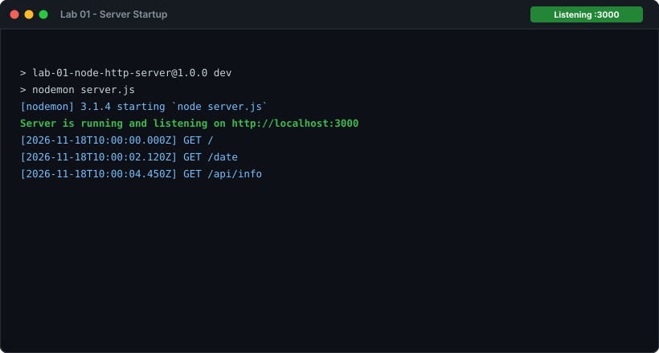
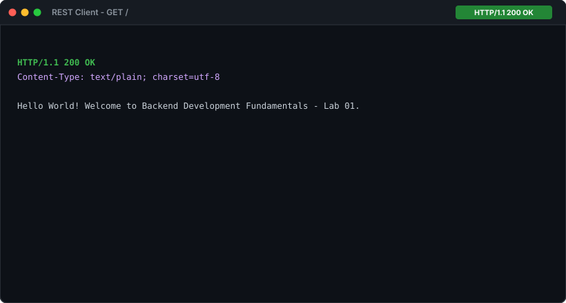
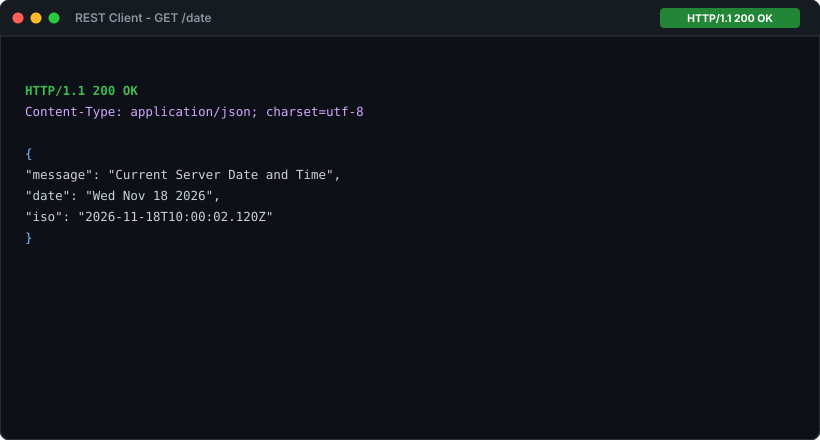
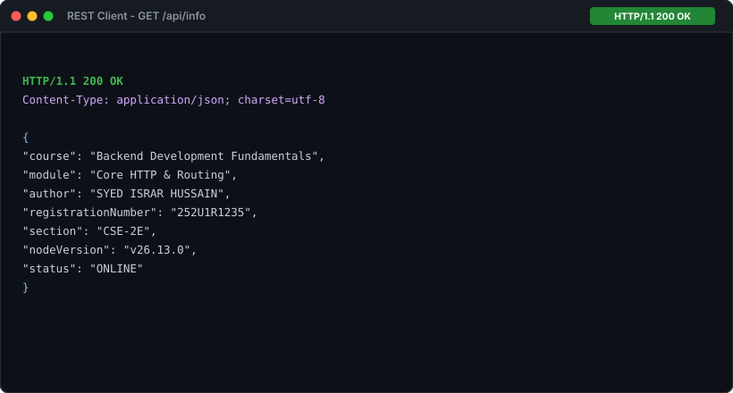

# Lab 1: Introduction to Node.js & Core HTTP Server

**Subject:** Backend Development Fundamentals  
**Academic Context:** Year II, Term II  
**Module:** Core HTTP Architecture and Server Routing  
**Author:** SYED ISRAR HUSSAIN  
**Registration Number:** 252U1R1235  
**Section:** CSE-2E  
**Deployment Status:** Local Development Environment (Academic Submission)

---

## 1. Objective
Understand Node.js event-driven runtime architecture, configure an Express application server, create basic routing mechanisms, set HTTP response headers, and serve dynamic text, HTML, and JSON representations.

---

## 2. Technologies Used
- **Node.js** (v26.13.0)
- **Express.js** (^4.19.2)
- **JavaScript (ES6+)**
- **Nodemon** (^3.1.4)
- **VS Code REST Client**

---

## 3. Project Structure
```text
lab-01/
├── app.http                 # HTTP test request definitions
├── package.json             # NPM dependencies & lifecycle scripts
├── server.js                # Express server and endpoint logic
├── .gitignore               # Excludes node_modules and logs
├── README.md                # Lab documentation
└── screenshots/             # Execution captures
    ├── get_date.png
    ├── get_date.svg
    ├── get_info.png
    ├── get_info.svg
    ├── get_root.png
    ├── get_root.svg
    ├── server_startup.png
    └── server_startup.svg
```

---

## 4. Installation and Setup Instructions (Windows PowerShell)

```powershell
cd d:\BDF\lab-01
npm install
npm run dev
```
The server will start listening on `http://localhost:3000`.

---

## 5. API Documentation

| HTTP Method | Route | Description | Content-Type | Status Code |
|:------------|:------|:------------|:-------------|:------------|
| `GET` | `/` | Returns welcome message and course identifier | `text/plain` | `200 OK` |
| `GET` | `/date` | Returns server clock in multiple formats | `application/json` | `200 OK` |
| `GET` | `/page` | Dynamically serves styled HTML response | `text/html` | `200 OK` |
| `GET` | `/api/info` | Returns runtime metadata, Node version, and student details | `application/json` | `200 OK` |

---

## 6. Screenshots

### Server Startup


### Root Endpoint (GET /)


### Current Date (GET /date)


### System Metadata (GET /api/info)


---

## 7. Problems Faced and Solutions
- **Port Collisions on Port 3000:** Resolved by terminating orphaned Node background processes via PowerShell (`Get-Process -Name node | Stop-Process -Force`).
- **MIME Header Handling:** Leveraged Express's native helper methods (`res.send()` vs `res.json()`) to ensure compliant header transmission.

---

## 8. Conclusion
Lab 1 verified the Node.js server lifecycle, routing tables, and client validation tools necessary for backend development.
