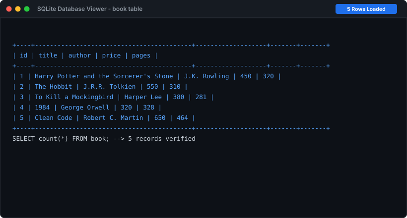
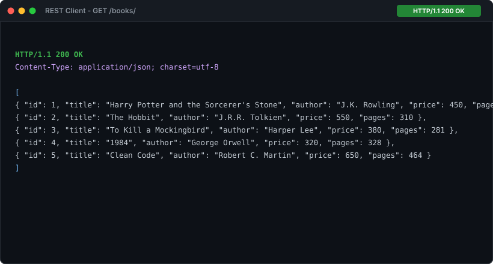
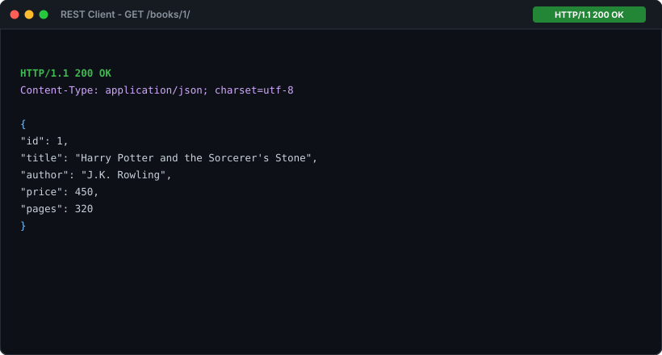
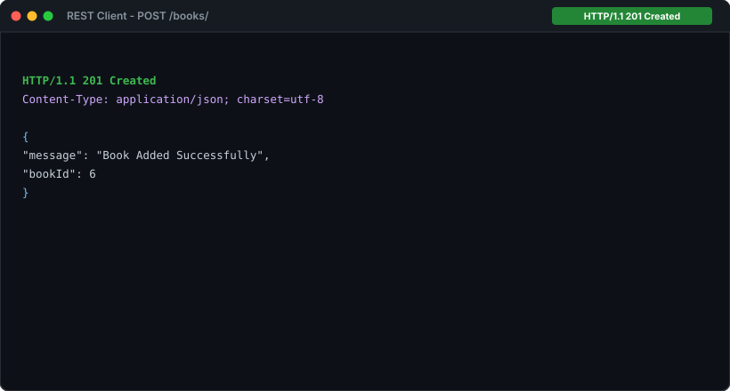
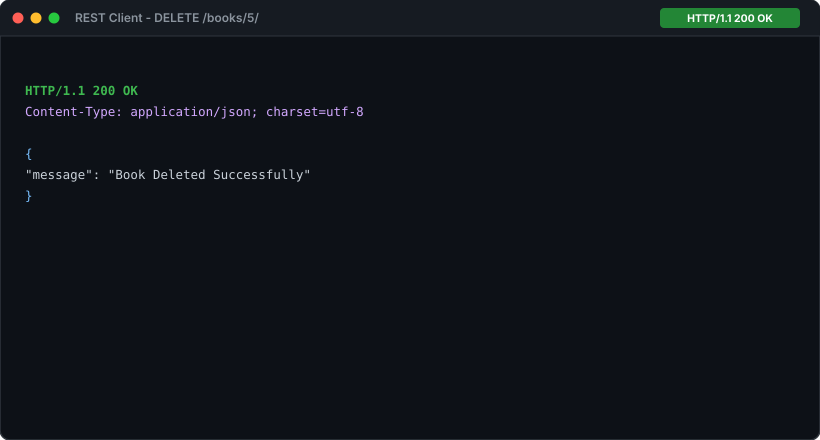

# Lab 2: SQLite Database and CRUD Routes

## 1. Lab Details
- **Lab Number:** 02
- **Subject:** Backend Development Fundamentals
- **Academic Context:** Year II, Term II
- **Module:** SQLite and relational database operations
- **Institution:** Aurora Higher Education Institution

---

## 2. Student Details
- **Name:** SYED ISRAR HUSSAIN
- **Registration Number:** 252U1R1235
- **Section:** CSE-2E

---

## 3. Objective
Connect an Express.js server to an SQLite relational database and expose complete Create, Read, Update, and Delete (CRUD) operations over HTTP REST endpoints utilizing asynchronous execution and parameterized query security.

---

## 4. Technologies Used
- **Node.js** (v26.13.0)
- **Express.js** (^4.19.2)
- **SQLite** (Embedded ACID-compliant database)
- **sqlite3** (^5.1.7) & **sqlite** (^5.1.1)
- **JavaScript (ES6+)** with `async/await`
- **Nodemon** (^3.1.4)
- **VS Code REST Client**

---

## 5. Project Structure
```text
lab-02/
├── app.http                 # VS Code REST Client test suite
├── package.json             # Express, sqlite, sqlite3 dependencies
├── server.js                # Express app, database connection & CRUD routes
├── .gitignore               # Excludes node_modules/ and sensitive files
├── README.md                # Exhaustive technical documentation
├── database/                # SQLite physical database storage
│   ├── bookStore.db         # Pre-configured SQLite binary database
│   └── init.sql             # Relational DDL schema & initial seed inserts
└── screenshots/             # Visual execution verifications
    ├── delete_book.png      # DELETE /books/:bookId/ response
    ├── delete_book.svg      # Vector render
    ├── get_all_books.png    # GET /books/ response
    ├── get_all_books.svg    # Vector render
    ├── get_book_by_id.png   # GET /books/:bookId/ response
    ├── get_book_by_id.svg   # Vector render
    ├── post_add_book.png    # POST /books/ response
    ├── post_add_book.svg    # Vector render
    ├── put_update_book.png  # PUT /books/:bookId/ response
    ├── put_update_book.svg  # Vector render
    ├── sqlite_database_view.png  # Terminal sqlite3 table grid view
    └── sqlite_database_view.svg  # Vector render
```

---

## 6. Database Design
The relational schema comprises the `book` table:

| Column Name | Data Type | Constraints | Description |
|:------------|:----------|:------------|:------------|
| `id` | `INTEGER` | `PRIMARY KEY AUTOINCREMENT` | Unique identifier for each book record |
| `title` | `TEXT` | `NOT NULL` | Full title of the publication |
| `author` | `TEXT` | `NOT NULL` | Author or primary contributor name |
| `price` | `INTEGER` | `NOT NULL` | Retail price in currency units (INR) |
| `pages` | `INTEGER` | `NOT NULL` | Total book page count |

### DDL Schema (`database/init.sql`):
```sql
CREATE TABLE IF NOT EXISTS book (
    id INTEGER PRIMARY KEY AUTOINCREMENT,
    title TEXT NOT NULL,
    author TEXT NOT NULL,
    price INTEGER NOT NULL,
    pages INTEGER NOT NULL
);
```

---

## 7. Sample Data
The database file `database/bookStore.db` contains 5 verified records:

| id | Title | Author | Price | Pages |
|:---|:------|:-------|:------|:------|
| 1 | Harry Potter and the Sorcerer's Stone | J.K. Rowling | 450 | 320 |
| 2 | The Hobbit | J.R.R. Tolkien | 550 | 310 |
| 3 | To Kill a Mockingbird | Harper Lee | 380 | 281 |
| 4 | 1984 | George Orwell | 320 | 328 |
| 5 | Clean Code | Robert C. Martin | 650 | 464 |

---

## 8. Installation Instructions (Windows PowerShell)

```powershell
cd d:\BDF\lab-02
npm install
```

---

## 9. Database Setup
The physical database file is pre-built and located at:
`database/bookStore.db`

> **Note:** The SQLite database is committed and ready for immediate execution. There is no need to recreate or delete the database file under standard evaluation conditions. 

If a manual reset is required:
```powershell
sqlite3 database/bookStore.db < database/init.sql
```

---

## 10. Running the Server

```powershell
npm run dev
```

**Port Configuration:**
The server runs on **Port 3000**:
`http://localhost:3000/`

---

## 11. API Documentation

| HTTP Method | Endpoint | Description | Request Body | Success Status | Error Status |
|:------------|:---------|:------------|:-------------|:---------------|:-------------|
| `GET` | `/books/` | Retrieves catalog of books sorted by ID ascending | None | `200 OK` | `500 Internal Server Error` |
| `GET` | `/books/:bookId/` | Retrieves a single book by `bookId` parameter | None | `200 OK` | `404 Not Found`, `500 Internal Server Error` |
| `POST` | `/books/` | Inserts a new book record into the `book` table | JSON (`title`, `author`, `price`, `pages`) | `201 Created` | `400 Bad Request`, `500 Internal Server Error` |
| `PUT` | `/books/:bookId/` | Updates an existing book identified by `bookId` | JSON (`title`, `author`, `price`, `pages`) | `200 OK` | `404 Not Found`, `500 Internal Server Error` |
| `DELETE` | `/books/:bookId/` | Deletes the book record matching `bookId` | None | `200 OK` | `404 Not Found`, `500 Internal Server Error` |

---

## 12. Request Examples

### 1. GET /books/
```http
GET http://localhost:3000/books/ HTTP/1.1
Accept: application/json
```
**Response:**
```json
HTTP/1.1 200 OK
Content-Type: application/json; charset=utf-8

[
  { "id": 1, "title": "Harry Potter and the Sorcerer's Stone", "author": "J.K. Rowling", "price": 450, "pages": 320 },
  { "id": 2, "title": "The Hobbit", "author": "J.R.R. Tolkien", "price": 550, "pages": 310 },
  { "id": 3, "title": "To Kill a Mockingbird", "author": "Harper Lee", "price": 380, "pages": 281 },
  { "id": 4, "title": "1984", "author": "George Orwell", "price": 320, "pages": 328 },
  { "id": 5, "title": "Clean Code", "author": "Robert C. Martin", "price": 650, "pages": 464 }
]
```

### 2. POST /books/
```http
POST http://localhost:3000/books/ HTTP/1.1
Content-Type: application/json

{
  "title": "Design Patterns: Elements of Reusable Object-Oriented Software",
  "author": "Erich Gamma, Richard Helm, Ralph Johnson, John Vlissides",
  "price": 750,
  "pages": 395
}
```
**Response:**
```json
HTTP/1.1 201 Created

{
  "message": "Book Added Successfully",
  "bookId": 6
}
```

---

## 13. SQL Injection Prevention

SQL Injection occurs when user input is concatenated into an SQL string:
```javascript
// DANGEROUS: Concatenation allows query manipulation
const query = `SELECT * FROM book WHERE id = ${bookId};`;
```

### Secured Approach in Lab 2:
```javascript
// SECURE: Parameterized query using ? placeholder
const query = `SELECT * FROM book WHERE id = ?;`;
const book = await db.get(query, [bookId]);
```
The database engine pre-compiles the query and binds user inputs strictly as literal values, rendering SQL injection impossible.

---

## 14. Screenshots

### SQLite Database View


### GET All Books


### GET Book by ID


### POST Add Book


### PUT Update Book


### DELETE Book


---

## 15. Deployment
- **Deployment Status:** Not Deployed (Local Development Environment)
- **Deployment URL:** `Not applicable (Local evaluation)`
- **Reason:** Lab 2 is structured as an offline academic lab submission utilizing local file-system embedded SQLite database (`database/bookStore.db`). Free-tier cloud containers (Render/Railway) feature ephemeral storage that resets database mutations on spin-down.

---

## 16. Problems Faced and Solutions
1. **Asynchronous Race Condition on Startup:** Addressed by nesting `app.listen()` inside `initializeDBAndServer()` after `sqlite.open()` resolves.
2. **Missing Record Handling:** Preemptively queried `SELECT id FROM book WHERE id = ?` before executing `UPDATE` or `DELETE`, returning `404 Not Found` when records do not exist.
3. **JSON Body Parsing:** Enabled `app.use(express.json())` middleware at the top of the Express pipeline.

---

## 17. Conclusion
Lab 2 implemented an enterprise-patterned Express CRUD interface on SQLite, establishing secure database parameterization, RESTful semantics, and proper status codes.

---

## 18. Viva Preparation

### Q1: Why await database calls?
> **Answer:** Database queries perform asynchronous disk I/O. Using `await` pauses execution until the query promise settles, preventing unhandled promise rejections and ensuring data is retrieved before sending the HTTP response.

### Q2: What is SQL injection?
> **Answer:** A vulnerability where malicious SQL commands are injected via untrusted input fields into dynamic SQL strings, compromising data confidentiality and integrity.

### Q3: How do placeholders prevent SQL injection?
> **Answer:** Placeholders (`?`) instruct the database to separate the query structure from the data values. User inputs are treated strictly as literals, eliminating any possibility of executing as code.

### Q4: When is PUT used instead of POST?
> **Answer:** `POST` is used to create a new resource at a server-assigned URL. `PUT` is idempotent and used to replace or update an existing resource at a known target URL.

### Q5: Why initialize the server after connecting to SQLite?
> **Answer:** To prevent requests from hitting route handlers before the database connection object (`db`) is initialized, which would cause null reference exceptions.
