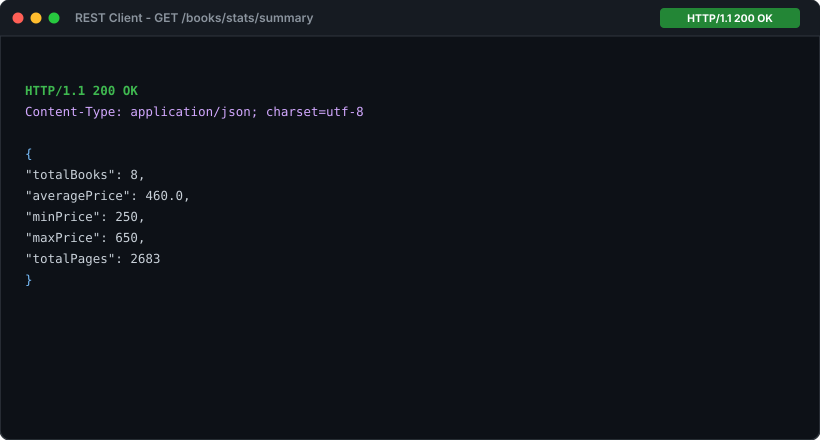

# Lab 3: Route Parameters, Query Parameters, and Advanced SQL Queries

**Subject:** Backend Development Fundamentals  
**Academic Context:** Year II, Term II  
**Module:** Advanced Express Routing & SQL Query Construction  
**Author:** SYED ISRAR HUSSAIN  
**Registration Number:** 252U1R1235  
**Section:** CSE-2E  
**Deployment Status:** Local Development Environment

---

## 1. Objective
Implement flexible backend query handling by combining Express route parameters, query string parameters (`search_q`, `limit`, `offset`, `order_by`, `order`), SQL pattern matching (`LIKE`), numeric range filtering, and aggregate database functions.

---

## 2. Technologies Used
- **Node.js** (v26.13.0)
- **Express.js** (^4.19.2)
- **SQLite & sqlite3**
- **JavaScript (ES6+)**
- **VS Code REST Client**

---

## 3. Project Structure
```text
lab-03/
├── app.http
├── package.json
├── server.js
├── .gitignore
├── README.md
├── database/
│   └── bookStore.db
└── screenshots/
    ├── search_pagination.png
    ├── search_pagination.svg
    ├── stats_summary.png
    └── stats_summary.svg
```

---

## 4. API Endpoints

| Method | Endpoint | Query / Path Parameters | Description |
|:-------|:---------|:------------------------|:------------|
| `GET` | `/books/` | `search_q`, `order_by`, `order`, `limit`, `offset` | Filter, sort, and paginate books |
| `GET` | `/books/filter` | `min_price`, `max_price` | Filter books within price boundary |
| `GET` | `/books/stats/summary` | None | Returns total count, average price, min/max price |
| `GET` | `/books/author/:authorName/` | `:authorName` (Path param) | Fetch all books by author pattern |

---

## 5. Screenshots

### Search and Pagination


### Aggregate Statistics


---

## 6. Viva Questions & Answers
- **Q: Difference between Route parameters and Query parameters?**  
  *A:* Route parameters (`/books/:id`) identify a specific resource, whereas query parameters (`/books?limit=5`) modify or filter the representation of that resource.
- **Q: Why sanitize ORDER BY columns?**  
  *A:* SQL parameter placeholders (`?`) cannot be used for column names or keywords (`ORDER BY ? ?`). An allow-list validation prevents SQL injection through sorting parameters.
