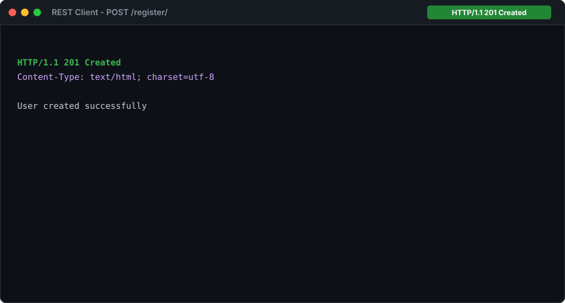
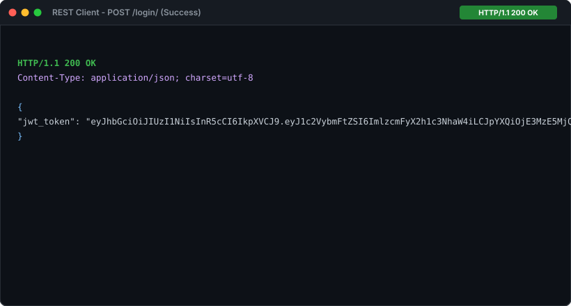
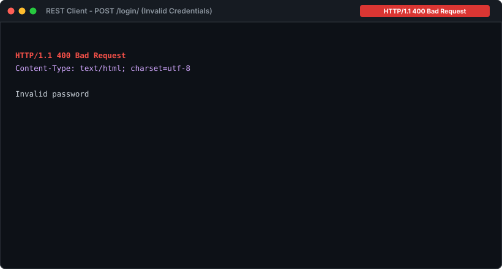
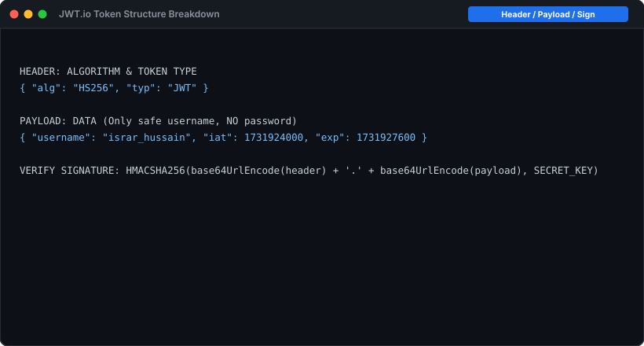

# Lab 4: Registration, Login and JWT

**Subject:** Backend Development Fundamentals  
**Academic Context:** Year II, Term II  
**Institution:** Aurora Higher Education Institution  
**Faculty:** Joel Prashanth D  
**Author:** SYED ISRAR HUSSAIN  
**Registration Number:** 252U1R1235  
**Section:** CSE-2E  
**Module:** Authentication and User Management  
**Deployment Status:** Local Development Environment

---

## 1. Objective
Add robust user registration and login workflows incorporating cryptographic password hashing using `bcrypt` and stateless session token issuance using JSON Web Tokens (`jsonwebtoken`).

---

## 2. Technologies Used
- **Node.js** (v26.13.0)
- **Express.js** (^4.19.2)
- **SQLite** (`users.db`)
- **bcrypt** (^5.1.1) - Adaptive password hashing
- **jsonwebtoken** (^9.0.2) - Signed stateless auth tokens
- **VS Code REST Client** & **jwt.io**

---

## 3. Project Structure
```text
lab-04/
├── app.http
├── package.json
├── server.js
├── .gitignore
├── README.md
├── database/
│   └── users.db
└── screenshots/
    ├── jwt_io_decode.png
    ├── jwt_io_decode.svg
    ├── post_login_invalid.png
    ├── post_login_invalid.svg
    ├── post_login_success.png
    ├── post_login_success.svg
    ├── post_register.png
    └── post_register.svg
```

---

## 4. API Documentation

| HTTP Method | Route | Description | Request Body | Success Status | Error Cases |
|:------------|:------|:------------|:-------------|:---------------|:------------|
| `POST` | `/register/` | Hashes password and registers new user | `{ username, name, password }` | `201 Created` | `400 Bad Request` ("User already exists") |
| `POST` | `/login/` | Verifies credentials and generates JWT | `{ username, password }` | `200 OK` (`{ jwt_token }`) | `400 Bad Request` ("Invalid user" / "Invalid password") |

---

## 5. Security Architecture
1. **Password Hashing (bcrypt):** Passwords are never saved in plaintext. `bcrypt.hash(password, 10)` generates a 60-character salt-hashed string.
2. **Minimal JWT Payload:** As required by security standards, only the `username` identifier is stored in the JWT payload. Passwords and sensitive secrets are strictly excluded.
3. **Secret Key Segregation:** The HMAC-SHA256 signature guarantees token tamper-proofing.

---

## 6. Screenshots

### User Registration


### Successful Login & JWT Token


### Rejected Wrong Credentials


### JWT Token Structure (jwt.io)


---

## 7. Viva Questions & Answers

### Q1: Why POST for login?
> **Answer:** `POST` transports sensitive credentials inside the HTTP request body over an encrypted TLS channel. Using `GET` would expose passwords in plaintext URL query strings, server access logs, and browser history.

### Q2: Hash vs Encrypt?
> **Answer:** Hashing is a one-way irreversible cryptographic transformation designed for passwords. Encryption is a two-way reversible process intended to protect data in transit or rest that must be decrypted later using a secret key.

### Q3: What does `jwt.sign()` need?
> **Answer:** It requires three arguments:
> 1. Payload data object (`{ username }`).
> 2. Secret / private key for cryptographic signature.
> 3. Optional configuration object (e.g. `{ expiresIn: '1h' }`, algorithm).

### Q4: What should never go into the payload?
> **Answer:** Passwords, API keys, Social Security Numbers, or confidential PII. JWT payloads are only Base64URL-encoded (not encrypted) and can be decoded and read by anyone possessing the token.
