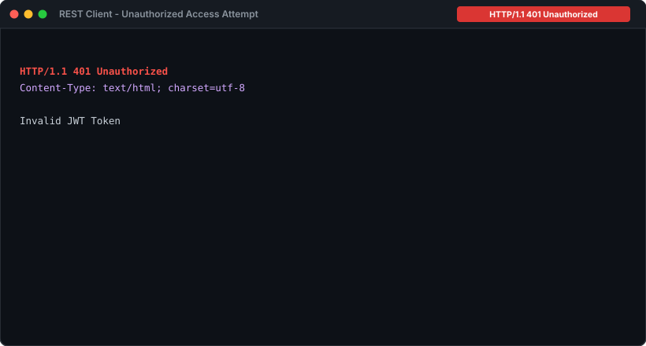
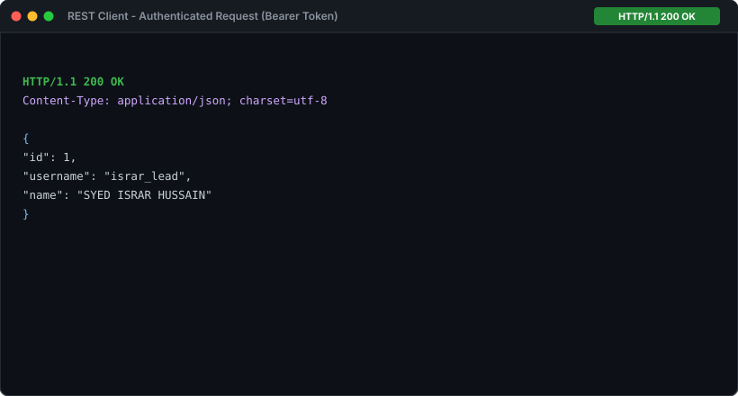

# Lab 5: Authentication Middleware and Protected Routes

**Subject:** Backend Development Fundamentals  
**Academic Context:** Year II, Term II  
**Module:** Authorization Middleware & Security Interceptors  
**Author:** SYED ISRAR HUSSAIN  
**Registration Number:** 252U1R1235  
**Section:** CSE-2E  
**Deployment Status:** Local Development Environment

---

## 1. Objective
Implement reusable Express middleware (`authenticateToken`) that inspects the HTTP `Authorization` request header, validates bearer tokens using cryptographic signatures, isolates user context, and protects sensitive CRUD endpoints against unauthorized access.

---

## 2. Technologies Used
- **Node.js** (v26.13.0)
- **Express.js** (^4.19.2)
- **SQLite** (`app.db`)
- **jsonwebtoken** & **bcrypt**
- **VS Code REST Client**

---

## 3. Project Structure
```text
lab-05/
├── app.http
├── package.json
├── server.js
├── .gitignore
├── README.md
├── database/
│   └── app.db
├── middleware/
│   └── authenticateToken.js
└── screenshots/
    ├── protected_route_200.png
    ├── protected_route_200.svg
    ├── protected_route_401.png
    └── protected_route_401.svg
```

---

## 4. API Endpoints

| Method | Endpoint | Protection | Description |
|:-------|:---------|:-----------|:------------|
| `POST` | `/login/` | Public | Authenticates credentials and returns JWT |
| `GET` | `/profile/` | Protected (`Bearer <token>`) | Returns logged-in user identity |
| `GET` | `/books/` | Protected (`Bearer <token>`) | Returns catalog of books |
| `POST` | `/books/` | Protected (`Bearer <token>`) | Adds a book tagged with user identity |

---

## 5. Screenshots

### Unauthorized 401 Block


### Protected Route 200 Access


---

## 6. Viva Questions & Answers
- **Q: What is middleware in Express?**  
  *A:* Middleware functions have access to the `request` and `response` objects, and the `next` function. They execute during the request-response cycle to execute code, transform payloads, or terminate requests (e.g. auth checks).
- **Q: How is the Authorization header formatted?**  
  *A:* Standard format is `Authorization: Bearer <JWT_STRING>`. The middleware splits the header string on spaces to extract index `[1]`.
