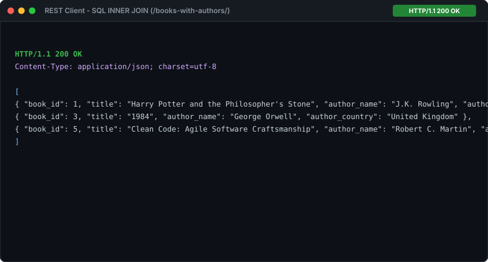
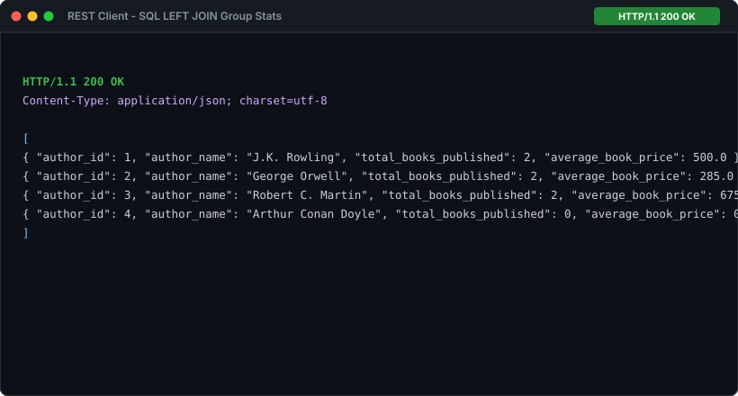

# Lab 6: Relational Schemas, Foreign Keys, and SQL Joins

**Subject:** Backend Development Fundamentals  
**Academic Context:** Year II, Term II  
**Module:** Relational Modeling & Complex Database Joins  
**Author:** SYED ISRAR HUSSAIN  
**Registration Number:** 252U1R1235  
**Section:** CSE-2E  
**Deployment Status:** Local Development Environment

---

## 1. Objective
Design and implement a normalized relational database schema with primary key / foreign key constraints, enforce referential integrity (`PRAGMA foreign_keys = ON`), and construct complex multi-table SQL queries utilizing `INNER JOIN`, `LEFT JOIN`, `GROUP BY`, and aggregate functions.

---

## 2. Technologies Used
- **Node.js** (v26.13.0)
- **Express.js** (^4.19.2)
- **SQLite** (`relational.db`)
- **SQL (DDL & DML)**
- **VS Code REST Client**

---

## 3. Project Structure
```text
lab-06/
├── app.http
├── package.json
├── server.js
├── .gitignore
├── README.md
├── database/
│   ├── relational.db
│   └── schema.sql
└── screenshots/
    ├── authors_stats_left_join.png
    ├── authors_stats_left_join.svg
    ├── inner_join_output.png
    └── inner_join_output.svg
```

---

## 4. Database Schema
- **author:** `id (PK), name, email (UNIQUE), country`
- **book:** `id (PK), title, author_id (FK -> author.id), price, pages`

---

## 5. API Documentation

| Method | Endpoint | Description |
|:-------|:---------|:------------|
| `GET` | `/authors/` | List all registered authors |
| `POST` | `/authors/` | Create a new author record |
| `GET` | `/authors/:authorId/books/` | Fetch author details and their associated books |
| `GET` | `/books-with-authors/` | SQL `INNER JOIN` combining books with author metadata |
| `GET` | `/authors-stats/` | SQL `LEFT JOIN` with `COUNT(book.id)` grouping |

---

## 6. Screenshots

### SQL INNER JOIN Output


### SQL LEFT JOIN & Aggregate Statistics


---

## 7. Viva Questions & Answers
- **Q: What is the difference between INNER JOIN and LEFT JOIN?**  
  *A:* `INNER JOIN` returns only records that have matching values in both tables. `LEFT JOIN` returns all records from the left table (e.g. `author`), and matched records from the right table (e.g. `book`); if there is no match, the right side returns `NULL`.
- **Q: Why must foreign keys be explicitly enabled in SQLite?**  
  *A:* For historical backwards compatibility, SQLite disables foreign key constraint enforcement by default. It must be activated at connection startup with `PRAGMA foreign_keys = ON;`.
