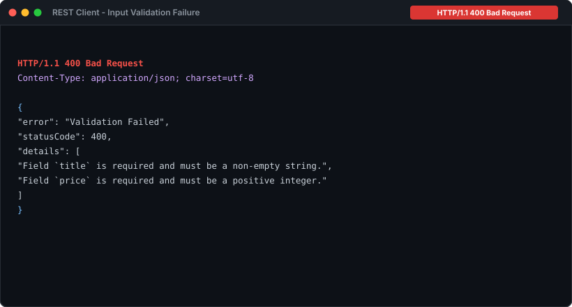
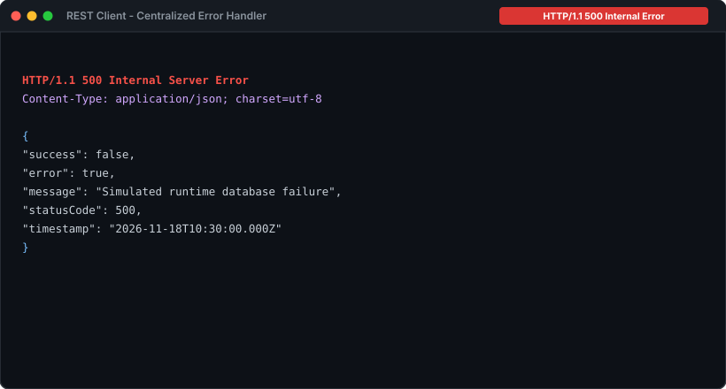

# Lab 7: Request Validation, Centralized Error Handling, and Logging

**Subject:** Backend Development Fundamentals  
**Academic Context:** Year II, Term II  
**Module:** Middleware Architecture & Resilience  
**Author:** SYED ISRAR HUSSAIN  
**Registration Number:** 252U1R1235  
**Section:** CSE-2E  
**Deployment Status:** Local Development Environment

---

## 1. Objective
Implement reusable request pipeline filters including strict schema input validation (`validateBook`), high-precision execution time request logging (`logger`), and a four-argument global error handling middleware (`errorHandler`) that intercepts unhandled rejections and standardizes error responses.

---

## 2. Technologies Used
- **Node.js** (v26.13.0)
- **Express.js** (^4.19.2)
- **SQLite** (`bookStore.db`)
- **VS Code REST Client**

---

## 3. Project Structure
```text
lab-07/
├── app.http
├── package.json
├── server.js
├── .gitignore
├── README.md
├── database/
│   └── bookStore.db
├── middleware/
│   ├── errorHandler.js
│   ├── logger.js
│   └── validateBook.js
└── screenshots/
    ├── centralized_error_500.png
    ├── centralized_error_500.svg
    ├── validation_error_400.png
    └── validation_error_400.svg
```

---

## 4. Middleware Architecture
1. **Request Logger (`logger.js`):** Intercepts all traffic, calculating execution latency via `Date.now()` and emitting ISO-formatted telemetry.
2. **Schema Validator (`validateBook.js`):** Intercepts `POST` payloads before reaching controller handlers, enforcing type constraints and non-empty bounds.
3. **Global Error Boundary (`errorHandler.js`):** Declared with `(err, req, res, next)` to ensure consistent structured JSON error formatting across all routes.

---

## 5. Screenshots

### Validation Failure (400 Bad Request)


### Centralized Error Handler (500 Error)


---

## 6. Viva Questions & Answers
- **Q: Why must an error handling middleware have four arguments?**  
  *A:* Express inspects the function signature length (`fn.length === 4`). Without `(err, req, res, next)`, Express treats the callback as a standard request middleware and will not route errors to it.
- **Q: Where should the centralized error handler be positioned in server.js?**  
  *A:* It must be mounted at the very end of the middleware chain, after all application route definitions, so that any error passed via `next(err)` bubbles down into it.
