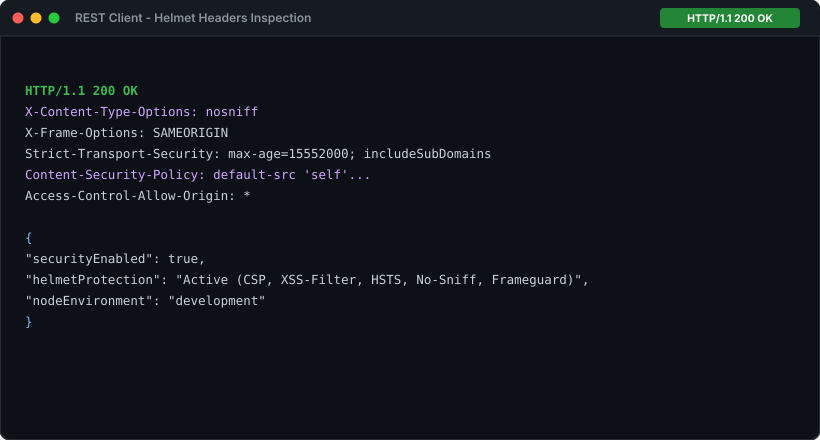

# Lab 8: Environment Variables, Security Hardening, and Configuration

**Subject:** Backend Development Fundamentals  
**Academic Context:** Year II, Term II  
**Module:** Backend Security, CORS & Environment Isolation  
**Author:** SYED ISRAR HUSSAIN  
**Registration Number:** 252U1R1235  
**Section:** CSE-2E  
**Deployment Status:** Local Development Environment

---

## 1. Objective
Isolate environment configuration from application source code using `dotenv`, implement HTTP security response headers utilizing `helmet`, enforce Cross-Origin Resource Sharing (`cors`) policies, and protect confidential database paths and keys.

---

## 2. Technologies Used
- **Node.js** (v26.13.0)
- **Express.js** (^4.19.2)
- **dotenv** (^16.4.5) - Process environment injector
- **helmet** (^7.1.0) - HTTP security headers
- **cors** (^2.8.5) - Cross-origin resource sharing middleware
- **SQLite**

---

## 3. Project Structure
```text
lab-08/
├── app.http
├── package.json
├── server.js
├── .env.example             # Safe template for environment variables
├── .gitignore               # Strict exclusion of real .env files
├── README.md
├── config/
│   └── env.js               # Centralized config module with fallbacks
├── database/
│   └── bookStore.db
└── screenshots/
    ├── security_headers_output.png
    └── security_headers_output.svg
```

---

## 4. Security Rules
1. **Never Commit Secrets:** The `.env` file is explicitly ignored in `.gitignore`. Only `.env.example` is committed to version control.
2. **Defensive Headers:** `helmet` sets `X-Content-Type-Options: nosniff`, `X-Frame-Options: SAMEORIGIN`, and restrictive Content Security Policies to mitigate clickjacking and MIME-type sniffing.

---

## 5. Screenshots

### Security Headers Inspection


---

## 6. Viva Questions & Answers
- **Q: Why should .env never be committed to Git?**  
  *A:* Committing secrets (JWT keys, DB passwords, API tokens) exposes credentials permanently in the Git commit history, creating critical security vulnerabilities if the repo is shared or made public.
- **Q: What does Helmet do in Express?**  
  *A:* Helmet sets 14+ HTTP response headers that protect Express applications against common web vulnerabilities (XSS, clickjacking, MIME sniffing, download attacks).
