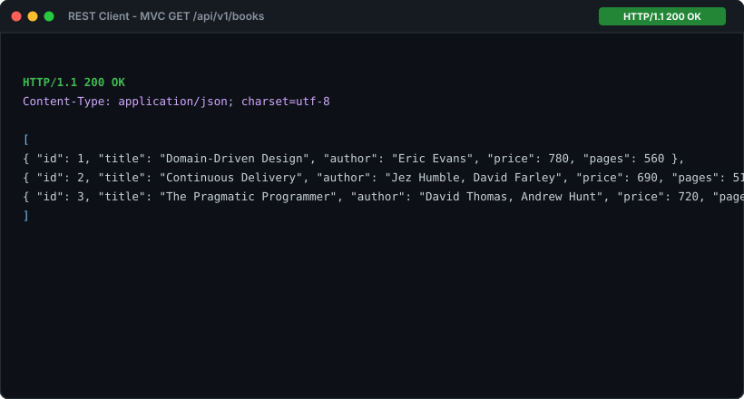
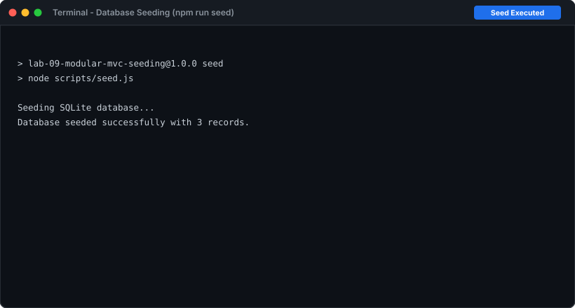

# Lab 9: Modular Architecture, MVC Pattern, and Database Seeding

**Subject:** Backend Development Fundamentals  
**Academic Context:** Year II, Term II  
**Module:** MVC Architecture & Enterprise Code Organization  
**Author:** SYED ISRAR HUSSAIN  
**Registration Number:** 252U1R1235  
**Section:** CSE-2E  
**Deployment Status:** Local Development Environment

---

## 1. Objective
Refactor monolithic backend architectures into an enterprise Model-View-Controller (MVC) pattern by separating database connection singletons (`src/config`), data access layers (`src/models`), HTTP handlers (`src/controllers`), and route routers (`src/routes`), supported by standalone seeding automation scripts.

---

## 2. Technologies Used
- **Node.js** (v26.13.0)
- **Express.js** (^4.19.2)
- **SQLite**
- **JavaScript (ES6+)**
- **VS Code REST Client**

---

## 3. Project Structure
```text
lab-09/
├── app.http
├── package.json
├── server.js                # Slim entrypoint configuring middleware & routers
├── .gitignore
├── README.md
├── database/
│   └── bookStore.db
├── scripts/
│   └── seed.js              # Standalone migration & seed utility
├── src/
│   ├── config/
│   │   └── db.js            # DB connection singleton
│   ├── controllers/
│   │   └── bookController.js# HTTP response logic
│   ├── models/
│   │   └── bookModel.js     # SQL query abstractions
│   └── routes/
│       └── bookRoutes.js    # Express Route mappings
└── screenshots/
    ├── mvc_get_books.png
    ├── mvc_get_books.svg
    ├── seed_script_output.png
    └── seed_script_output.svg
```

---

## 4. Architecture Layers
1. **Model (`bookModel.js`):** Contains pure database logic. No HTTP request/response dependencies exist here.
2. **Controller (`bookController.js`):** Handles request validation, orchestrates model interactions, and formats JSON outputs.
3. **Router (`bookRoutes.js`):** Maps REST verbs and URI paths to controller methods.

---

## 5. Screenshots

### MVC Endpoint Response


### Database Seed Execution


---

## 6. Viva Questions & Answers
- **Q: What benefits does MVC offer over a single server.js file?**  
  *A:* MVC enforces separation of concerns, improves unit-testability, allows independent development of database schemas and HTTP handlers, and prevents single-file cognitive overload.
- **Q: Why separate database seeding into scripts/seed.js?**  
  *A:* Production servers must not re-create or wipe tables on every application restart. Seeding is an administrative lifecycle operation that should run independently via CLI commands.
