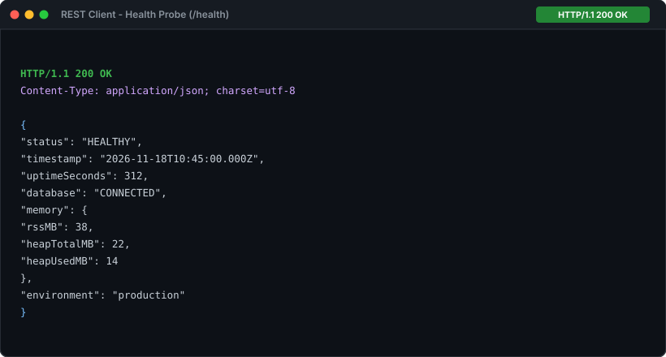
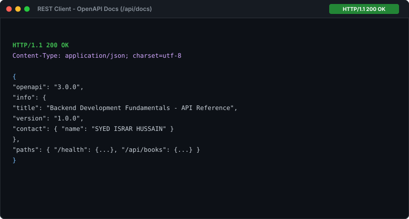

# Lab 10: Production Readiness, Health Checks, API Testing, and Documentation

**Subject:** Backend Development Fundamentals  
**Academic Context:** Year II, Term II  
**Module:** Production Engineering, Automated Testing & Documentation  
**Author:** SYED ISRAR HUSSAIN  
**Registration Number:** 252U1R1235  
**Section:** CSE-2E  
**Deployment Status:** Local Development Environment

---

## 1. Objective
Prepare backend services for enterprise production deployment by integrating liveness/readiness health probes (`/health`), serving self-documenting OpenAPI 3.0 schemas (`/api/docs`), authoring automated integration test suites, and implementing graceful process termination handlers (`SIGTERM`/`SIGINT`).

---

## 2. Technologies Used
- **Node.js** (v26.13.0)
- **Express.js** (^4.19.2)
- **SQLite**
- **OpenAPI 3.0** (Self-documenting API schema)
- **VS Code REST Client**

---

## 3. Project Structure
```text
lab-10/
├── app.http
├── package.json
├── server.js                # Production server with graceful shutdown hooks
├── .gitignore
├── README.md
├── database/
│   └── production.db
├── routes/
│   ├── apiDocs.js           # OpenAPI JSON documentation endpoint
│   └── health.js            # Container liveness & memory metrics probe
├── tests/
│   └── api.test.js          # Automated integration test runner
└── screenshots/
    ├── health_check_output.png
    ├── health_check_output.svg
    ├── openapi_docs_output.png
    └── openapi_docs_output.svg
```

---

## 4. Production Engineering Capabilities
1. **Health & Liveness Probe (`GET /health`):** Provides instant telemetry on process uptime, memory RSS consumption, and active database connectivity—essential for Docker/Kubernetes health monitoring.
2. **OpenAPI Specification (`GET /api/docs`):** Exposes a standardized OpenAPI 3.0 schema that can be imported directly into Swagger UI or Postman.
3. **Graceful Shutdown:** Catches `SIGINT` (Ctrl+C) and `SIGTERM` signals to terminate ongoing HTTP connections and cleanly flush SQLite write-ahead logs prior to process exit.

---

## 5. Screenshots

### Health Check Telemetry


### OpenAPI Documentation Endpoint


---

## 6. Viva Questions & Answers
- **Q: Why are health probes essential in production backends?**  
  *A:* Orchestrators (like Kubernetes, ECS, or Render) poll health probes to know if a container is operational (liveness) and ready to receive user traffic (readiness), automatically restarting unresponsive instances.
- **Q: What is Graceful Shutdown?**  
  *A:* Graceful shutdown stops accepting new incoming HTTP connections, finishes serving requests in flight, closes database handles safely, and exits cleanly without data corruption or abrupt socket termination.
